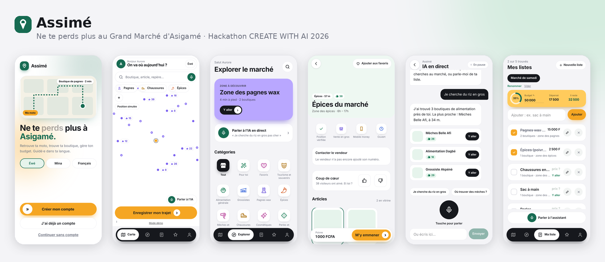

# Assimé

**Ne te perds plus au Grand Marché d'Asigamé.**
Retrouve ta moto, trouve la bonne boutique, gère ta liste et ton budget, guidé·e dans ta langue.



> Projet présenté au **Hackathon CREATE WITH AI 2026** (Association des Jeunes Nocodeurs, Lomé).
> Version **1.4.0** — front-end complet, **agent Gemini avec outils**, **guidage par les rues**, **back-end Supabase** (boutiques, photos, coups de cœur partagés).

---

## Sommaire

1. [Le problème et notre réponse](#1-le-problème-et-notre-réponse)
2. [Fonctionnalités](#2-fonctionnalités)
3. [Démarrer en 2 minutes](#3-démarrer-en-2-minutes)
4. [Mettre en ligne (Vercel)](#4-mettre-en-ligne-vercel)
5. [Organisation du code](#5-organisation-du-code)
6. [Travailler à plusieurs](#6-travailler-à-plusieurs)
7. [Limites connues et suite](#7-limites-connues-et-suite)
8. [Documentation détaillée](#8-documentation-détaillée)

---

## 1. Le problème et notre réponse

Le Grand Marché d'Asigamé est immense, dense, sans plan. On s'y perd, on ne retrouve plus sa moto, on tourne longtemps avant de trouver le bon stand. Les vendeurs, eux, ont du mal à être trouvés.

**Assimé** est une application web installable sur téléphone (PWA) qui :

- **enregistre ton chemin** depuis le parking et te **ramène à ta moto** par le plus court ;
- te **guide jusqu'aux boutiques et repères** (cathédrale, banques, pharmacie…) ;
- répond quand tu **parles à l'IA** (« je cherche du riz en gros pas cher ») ;
- tient ta **liste de courses et ton budget** à la voix (« j'ai trouvé les chaussures à 8 000 ») ;
- permet aux **vendeurs** de placer leur stand, leurs photos, leurs articles et leur WhatsApp ;
- affiche la **confiance** grâce aux *coups de cœur* (pouces) laissés par les visiteurs.

## 2. Fonctionnalités

| Domaine | Ce qui marche | Écran |
| --- | --- | --- |
| **Compte** | Inscription (prénom, téléphone, acheteur/vendeur), connexion par code SMS ou WhatsApp (démo : tout code à 6 chiffres) | `/bienvenue` `/inscription` `/connexion` |
| **Carte** | Position GPS, boutiques et repères, recherche, raccourcis personnalisables, langue (éwé / mina / français) | `/carte` |
| **Trajet** | Enregistrement GPS filtré, **arrêts** (pause puis « Poursuivre »), mode démo | `/trajet` |
| **Retour à la moto** | Chemin inverse **sans les boucles**, distance, temps, voix, bouton « Couper le son » | `/retour` |
| **Guidage** | **Par les vraies rues** (OpenStreetMap), distance réelle, consigne de virage, arrêts, coup de cœur à l'arrivée | `/guidage/:id` |
| **Recherche** | Langage naturel, micro, boutiques Assimé, repères du marché, lieux OpenStreetMap (Ramco, Ecobank…) | `/recherche` |
| **IA en direct (Gemini)** | Conversation vocale continue : on parle, Gemini répond à voix haute puis réécoute. Repli automatique sur l'IA locale sans réseau | `/ia` |
| **Explorer** | Zone à découvrir, filtres (Pour toi par l'IA, Favoris, Tourisme, Alimentation, Grossistes, catégories) | `/explorer` |
| **Fiche boutique** | Photos, articles, contact (appel / WhatsApp), favoris, coups de cœur | `/boutique/:id` |
| **Coups de cœur** | 👍 visibles sur la carte. 👎 **jamais affiché** : il retire un 👍 et n'est vu que par le vendeur | partout |
| **Ma liste** | Plusieurs listes, budget, dépensé / reste, ajout, modification, boutiques suggérées | `/liste` |
| **Assistant de liste (Gemini)** | « J'ai trouvé… à… », « ajoute… », « combien il me reste ? », « si je prends… » | `/assistant` |
| **Missions** | Points et niveaux (acheteur et vendeur) pour enrichir la carte | `/missions` |
| **Espace vendeur** | Couverture, logo, catégorie libre, position GPS, téléphone, WhatsApp, horaires, articles avec photos et stock, coups de cœur privés | `/vendeur` |

Captures de tous les écrans : [`docs/captures/`](docs/captures).

## 3. Démarrer en 2 minutes

Prérequis : **Node.js 20.19 ou plus récent** (voir `.nvmrc`).

```bash
npm install        # installe les dépendances
npm run dev        # lance l'app sur http://localhost:5173
```

`npm run dev` affiche aussi une adresse réseau (`http://192.168.x.x:5173`) pour ouvrir l'app sur un téléphone connecté au même Wi-Fi.

| Commande | Rôle |
| --- | --- |
| `npm run dev` | Serveur de développement avec rechargement automatique |
| `npm run build` | Version de production dans `dist/` |
| `npm run preview` | Tester la version de production en local |
| `npm run lint` | Vérifier la qualité du code (ESLint) |
| `npm run carte` | Télécharger les rues OpenStreetMap autour du marché (guidage hors ligne) |

**Pour tester sans marcher au marché** : sur la carte, touche **« Mode démo »**. Un trajet avec une boucle est simulé depuis le parking.

**Pour activer la vraie IA (Gemini)** : copier `.env.example` en `.env.local` et y coller une clé gratuite de [aistudio.google.com/apikey](https://aistudio.google.com/apikey). Sans clé, l'app marche avec l'IA locale. Détails : [`docs/IA.md`](docs/IA.md).

> ⚠️ Le **GPS** et le **micro** ne fonctionnent que sur **https** (ou `localhost`). Pour un vrai test au marché, utilise la version en ligne.

## 4. Mettre en ligne (Vercel)

1. Créer un dépôt GitHub et y pousser ce dossier.
2. Sur [vercel.com](https://vercel.com) → **Add New… → Project** → choisir le dépôt.
3. Vercel détecte **Vite** tout seul. Laisser les réglages par défaut, cliquer **Deploy**.
4. Dans **Settings → Environment Variables**, ajouter `GEMINI_API_KEY` (ta clé Gemini), puis **Redeploy**.
5. Chaque `git push` sur `main` redéploie automatiquement.

Le fichier `vercel.json` redirige toutes les routes vers l'app (les liens directs comme `/carte` fonctionnent). Guide détaillé : [`docs/DEPLOIEMENT.md`](docs/DEPLOIEMENT.md).

## 5. Organisation du code

```
assime/
├── api/
│   ├── ia.js                  Agent Gemini (clé cachée sur le serveur)
│   └── _outils.js             Outils de l'agent : boutiques, prix, trajet, carte de Lomé, internet
├── supabase/                  Base de données : schema.sql, seed.sql, tests de sécurité
├── index.html                 Page d'entrée, polices, PWA
├── public/                    Icône et manifeste (installation sur téléphone)
├── src/
│   ├── main.jsx               Routes de l'application
│   ├── store.jsx              État global : compte, trajet, listes, boutiques, votes
│   ├── index.css              Thème (couleurs, boutons, cartes)
│   ├── data/demo.js           Boutiques, repères, sections, missions de démonstration
│   ├── lib/
│   │   ├── geo.js             Distances, directions, coupe des boucles du trajet
│   │   ├── ia.js              Appel à Gemini + IA locale de secours
│   │   ├── voix.js            Micro (reconnaissance) et voix (synthèse)
│   │   ├── carte.js           Recherche de lieux à Lomé (OpenStreetMap)
│   │   ├── itineraire.js      Plus court chemin à pied par les rues
│   │   ├── image.js           Réduction des photos avant enregistrement
│   │   └── supabase.js        Connexion à la base partagée (compte anonyme, photos, temps réel)
│   ├── components/
│   │   ├── MapView.jsx        Carte Leaflet (satellite / plan, marqueurs)
│   │   ├── ui.jsx             Barre du bas, en-têtes, boutons, vote coup de cœur
│   │   └── art.jsx            Icônes, visuels, jauge du budget
│   └── pages/
│       ├── Entree.jsx         Bienvenue, inscription, connexion, code, rôle
│       ├── Navigation.jsx     Carte, trajet, retour, recherche, boutique, guidage
│       ├── Autres.jsx         Explorer, liste, assistant, missions, profil
│       ├── IA.jsx             IA en direct
│       └── Vendeur.jsx        Espace vendeur, fiche boutique, articles
└── docs/                      Documentation et captures
```

**Stack** : React 19 · Vite 8 · Tailwind CSS 4 · React Router 7 · Leaflet · Phosphor Icons · Google Gemini (fonction Vercel) · Supabase.
Aucune clé nécessaire pour lancer la démo : sans clé Gemini, l'IA locale prend le relais.

## 6. Travailler à plusieurs

- Une **branche par tâche** : `git checkout -b feature/nom-court`, puis une Pull Request vers `main`.
- Avant chaque Pull Request : `npm run lint` et `npm run build` doivent passer.
- Messages de commit courts et en français : `ajoute le vote coup de cœur`, `corrige le scroll de la liste`.
- Les textes de l'interface sont en **français simple** (tutoiement, phrases courtes).
- Ne jamais mettre de clé d'API dans le code ni dans un fichier envoyé sur GitHub (voir `.env.example`).

Répartition proposée et points d'entrée par rôle : [`docs/ARCHITECTURE.md`](docs/ARCHITECTURE.md#qui-touche-à-quoi).

## 7. Limites connues et suite

| Aujourd'hui (démo) | Prochaine étape |
| --- | --- |
| ~~Données gardées dans le téléphone~~ | ✅ **Supabase prêt** : il suffit de créer le projet et de mettre 2 clés → [`docs/BACKEND.md`](docs/BACKEND.md) |
| Code de connexion simulé (comptes anonymes côté base) | Vrai SMS / WhatsApp (OTP) |
| ~~IA à règles, en local~~ | ✅ **Agent Gemini avec outils** (`/api/ia`), IA locale gardée en secours |
| ~~Guidage en ligne droite~~ | ✅ **Par les rues OpenStreetMap**. Suite : allées intérieures par relevé terrain → [`docs/CARTOGRAPHIE.md`](docs/CARTOGRAPHIE.md) |
| Voix en français | Fichiers audio **éwé / mina** enregistrés |
| Positions des boutiques et repères **approximatives** | Relevé terrain au marché |
| Bouton Satellite / Plan masqué sur la carte d'accueil | À réactiver (`showToggle` dans `Carte`) si besoin |

## 8. Documentation détaillée

| Document | Pour qui | Contenu |
| --- | --- | --- |
| [`docs/GUIDE-DEMO.md`](docs/GUIDE-DEMO.md) | Toute l'équipe | Le parcours de démo pour le jury, minute par minute |
| [`docs/ARCHITECTURE.md`](docs/ARCHITECTURE.md) | Développeurs | Fonctionnement interne, état, règles métier, qui touche à quoi |
| [`docs/IA.md`](docs/IA.md) | IA | Fonctionnement de Gemini, activation de la clé, dépannage |
| [`docs/CARTOGRAPHIE.md`](docs/CARTOGRAPHIE.md) | Carte, terrain | Guidage par les rues, `npm run carte`, futur relevé terrain |
| [`docs/BACKEND.md`](docs/BACKEND.md) | Back-end | **Mise en place Supabase pas à pas**, sécurité, tests |
| [`docs/DESIGN.md`](docs/DESIGN.md) | Design, front | Couleurs, typographie, composants, règles visuelles |
| [`docs/DEPLOIEMENT.md`](docs/DEPLOIEMENT.md) | Toute l'équipe | Mise en ligne pas à pas et dépannage |
| [`CHANGELOG.md`](CHANGELOG.md) | Toute l'équipe | Ce qui a changé, version par version |

---

Cartes : © Esri (imagerie), © contributeurs OpenStreetMap · Icônes : Phosphor Icons (MIT).
